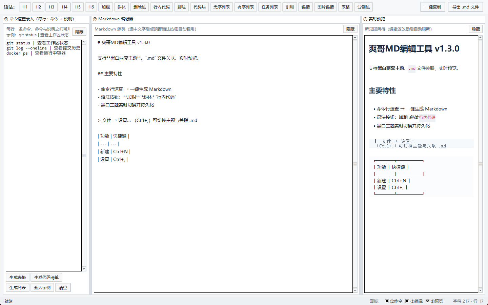
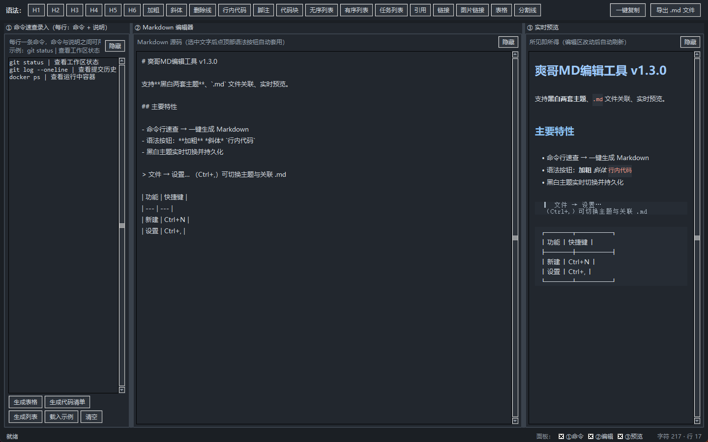
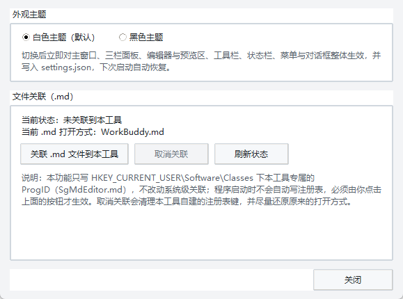
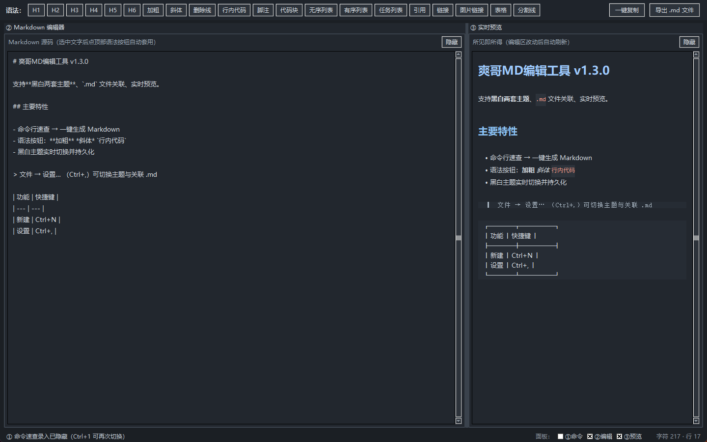

# 爽哥MD编辑工具 · SgMdEditor

[](https://github.com/yangshuang9889/MdCmdTool/actions/workflows/build.yml)
[](https://github.com/yangshuang9889/MdCmdTool/releases)
[](LICENSE)
[](https://github.com/yangshuang9889/MdCmdTool/releases)
[](https://www.python.org/)

> 一个只用 Python 标准库写的 Windows 桌面 Markdown 工具：**左边录命令、右边出文档**。
> 把一堆「命令 + 说明」粘进左栏，一次点击就能生成 Markdown 表格 / 代码清单 / 列表，右栏边写边预览，导出的 `.md` 直接能贴进 GitHub、语雀、博客或项目文档。
> 单文件 exe，免安装、无运行库依赖、不联网也能用。

---

## 目录

- [为什么做它](#为什么做它)
- [功能特性](#功能特性)
- [界面预览](#界面预览)
- [下载与运行](#下载与运行)
- [快速上手](#快速上手)
- [快捷键与菜单](#快捷键与菜单)
- [在线检查更新](#在线检查更新)
- [从源码构建](#从源码构建)
- [项目结构](#项目结构)
- [数据与隐私](#数据与隐私)
- [常见问题](#常见问题)
- [反馈与贡献](#反馈与贡献)
- [许可证](#许可证)

---

## 为什么做它

写逆向分析笔记、工具说明、命令手册时，最烦的不是写内容，而是**排版**：几十条命令要一条条对齐成表格，每个参数都要加粗、加反引号、加说明。手打一遍，人已经累了。

这个工具的思路很简单：

1. **左栏只填两列**——命令、说明（一行一条，或在「命令」框写多行命令，说明框用 `|` 或换行分开）；
2. **一键生成**——按需要生成 `表格` / `代码清单` / `列表` 三种排版；
3. **右栏实时预览**——改一个字，预览立刻跟着变；
4. **导出或复制**——存成 `.md`，或一键复制全文粘到任何地方。

它不追求做「全能 Markdown 编辑器」（那些已经有 Typora、Obsidian），只把「**命令速查表 → 规范 Markdown**」这一件事做到不用返工。

## 功能特性

**命令速查表生成（核心）**

- 左栏两组输入框：命令 / 说明，支持批量粘贴；
- 三种输出排版：`生成表格`、`生成代码清单`、`生成列表`，自动处理 `|` 转义、反引号包裹、空行与缩进；
- `载入示例` 一键灌入示例数据，先看效果再动手。

**Markdown 编辑**

- 21 个语法按钮（v1.7.0 增加「插入图片」）：`H1`~`H6`、加粗、斜体、删除线、行内代码、脚注、代码块、无序/有序/任务列表、引用、链接、图片、表格模板、分割线；
- 支持**选中即套用**：先选文字再点按钮，直接在选区两端插入标记；脚注自动递增序号；
- 三栏布局（左：命令录入 / 中：Markdown 源码 / 右：实时预览），任意一栏都能隐藏，`Ctrl+1/2/3` 切换，至少保留一栏；
- 面板宽度、窗口位置与大小自动记住，下次打开还原原样。

**图片显示（v1.7.0）**

- 预览区把 `` **渲染成真实图片**：`PNG` / `JPG` / `JPEG` / `GIF` / `BMP` / `WEBP` 都能直接看；
- 相对路径以**当前文档所在目录**为基准，绝对路径与 `file:///` 写法同样支持，中文与含空格路径也能识别；
- 按预览区宽度等比缩放（最大高度 480px），改窗口大小自动重排，图片不会撑破预览区；
- 单击预览里的图片即用系统看图程序**打开原图**；
- 工具栏新增 **插入图片** 按钮（`Ctrl+Shift+I`）：选好本地图片自动写入相对路径，路径含空格自动用 `<>` 包裹；
- 网络图 / Base64 / 文件不存在时只显示一行提示文字，不影响其余内容渲染，也不会弹错误框。

**主题与外观**

- 黑 / 白两套主题，切换后整窗（含菜单、编辑器、预览、状态栏、对话框）即时生效，选择持久保存；
- 自带多尺寸图标，`.md` 文件配专用图标。

**文件与系统集成（可选）**

- 保存 / 另存为 / 打开 / 新建，编码自动回退（UTF-8 → UTF-8 BOM → GBK），不会因为编码猜错把中文读成乱码；
- **未保存修改提示**：有改动时新建 / 打开 / 退出都先问「保存 / 不保存 / 取消」，不会静默丢内容；
- **单实例 + 双击转交**：程序已在运行时，双击 `.md` 不再新起一堆进程，文件直接送进当前窗口；
- **`.md` 文件关联**：设置窗口里点一下即可关联本工具（仅写 `HKCU\Software\Classes`，随时可一键取消并还原原打开方式）。**程序启动时绝不自动改注册表**。

**工程细节**

- 零第三方依赖：只用 `tkinter`、`urllib`、`socket`、`ctypes` 等标准库，源码可直接跑；
- 单文件 exe，PyInstaller `--onefile --noconsole` 打包，双击即用；
- 全程写滚动日志（`%LOCALAPPDATA%\爽哥MD编辑工具\logs\`），崩溃有兜底弹窗与日志，方便反馈问题；
- 中文界面，快捷键全中文提示。

## 界面预览

| 白色主题 | 黑色主题 |
| --- | --- |
|  |  |

| 设置窗口 | 隐藏左右两栏 |
| --- | --- |
|  |  |

## 下载与运行

1. 打开 [Releases](https://github.com/yangshuang9889/MdCmdTool/releases) 页；
2. 下载最新版本的 `SgMdEditor-v1.7.0.exe`（后续版本同名规则 `SgMdEditor-<版本>.exe`），双击即用，无需安装；
3. 双击运行。**免安装**，不需要 Python 环境，不需要任何运行库。

> 系统要求：Windows 10 / 11（x64）。程序无代码签名，首次运行若被 SmartScreen 提示，可点「更多信息 → 仍要运行」；也可以按[从源码构建](#从源码构建)自行打包。

## 快速上手

**场景：把一份命令清单整理成表格**

1. 打开程序，左栏「命令」框粘贴命令（一行一条），「说明」框粘贴对应说明（行数与命令一致，或用 `|` 分隔）；
2. 点 `生成表格`，中栏出现规范 Markdown 表格，右栏立刻看到渲染效果；
3. 需要别的排版就点 `生成代码清单` 或 `生成列表`；
4. 点右上角 `导出 .md 文件` 存盘，或 `一键复制` 直接粘走。

**场景：给 `.md` 文件加双击打开**

1. `Ctrl+,` 打开设置窗口；
2. 点「关联 .md 文件到本工具」，状态行显示已关联即可；
3. 以后双击任意 `.md` 就用本工具打开；不想用了回来点「取消关联」。

## 快捷键与菜单

| 快捷键 | 功能 |
| --- | --- |
| `Ctrl+N` | 新建文档（先走未保存确认） |
| `Ctrl+O` | 打开 Markdown 文件（先走未保存确认） |
| `Ctrl+S` | 保存当前文件（无路径时转为另存为） |
| `Ctrl+Shift+S` | 另存为 |
| `Ctrl+Shift+C` | 一键复制全部内容 |
| `Ctrl+,` | 打开设置窗口 |
| `Ctrl+1` / `Ctrl+2` / `Ctrl+3` | 显示 / 隐藏第 1 / 2 / 3 栏 |
| `F1` | 使用说明 |

| 菜单 | 菜单项 |
| --- | --- |
| 文件 | 新建、打开 Markdown...、保存、另存为...、设置...、退出 |
| 编辑 | 撤销、重做、全选、复制全部内容到剪贴板 |
| 视图 | 显示①、显示②、显示③、显示全部面板 |
| 帮助 | **检查更新...**、使用说明、日志与问题反馈、关于 |

完整的行为说明、行号级实现细节与踩坑记录见 [开发手册.md](%E5%BC%80%E5%8F%91%E6%89%8B%E5%86%8C.md)，日常使用问答见 [使用说明.md](%E4%BD%BF%E7%94%A8%E8%AF%B4%E6%98%8E.md)。

## 在线检查更新

v1.6.0 起，程序可以**用本仓库的 Releases 做版本比对**：

- 入口：`帮助 → 检查更新...`，或关于窗口里的「检查更新」按钮，或设置窗口的「立即检查更新」；
- 原理：请求 GitHub 官方接口 `https://api.github.com/repos/yangshuang9889/MdCmdTool/releases/latest`，取 `tag_name` 与本地 `APP_VERSION` 比较，同时把该版本的更新说明展示出来；
- 结果分三种：**有新版本**（给出发布页/下载入口）、**已是最新**、**本地更高（开发版）**；
- 启动时自动检查默认**关闭**，可在设置窗口打开。开启后只在状态栏留一行提示，**绝不弹窗打断**；
- 网络请求在后台线程执行，`8 秒` 超时，失败只在弹窗里说明原因，不影响编辑；
- 它**只读、不下载、不安装、不改动任何文件**：发现新版本后，是否下载安装完全由你自己决定。

> 由于检查更新依赖「最新版本以 Release 发布」这一约定，维护者在发版时会同步创建对应 tag 的 Release（见 `CHANGELOG.md`）。

## 从源码构建

只需要 Python 3.8+（开发与打包使用 3.12）和标准库，运行源码不需要装任何依赖：

```bat
python 爽哥MD命令生成工具.py
```

打包为单文件 exe：

```bat
build.bat
```

`build.bat` 会调用 PyInstaller（首次打包前执行 `pip install pyinstaller`），产出根目录下的 `爽哥MD编辑工具.exe`，并清理 `build/`、`dist/`、`__pycache__`、`*.spec` 等中间产物。

等价的打包命令（Windows 路径分隔符为 `;`）：

```bat
python -m PyInstaller --noconfirm --onefile --noconsole ^
  --name "爽哥MD编辑工具" --icon app.ico ^
  --add-data "app.ico;." --add-data "md_file.ico;." ^
  --add-data "app_icon.png;." --add-data "md_file_icon.png;." ^
  --version-file version_info.txt "爽哥MD命令生成工具.py"
```

版本号需要同步的 5 处：`APP_VERSION`、`version_info.txt` 的 `filevers/prodvers/FileVersion/ProductVersion`、窗口标题、`使用说明.md` 页首、`开发手册.md` 版本记录。

## 项目结构

```text
MdCmdTool/
├─ 爽哥MD命令生成工具.py     # 主程序源码（单文件，仅标准库）
├─ version_info.txt          # exe 版本资源（公司名：杨爽工作室）
├─ build.bat                 # 一键打包脚本
├─ make_icons.py             # 由设计稿生成多尺寸 ico
├─ app.ico / md_file.ico     # 程序图标 / .md 文件图标
├─ app_icon.png / md_file_icon.png
├─ 开发手册.md               # 11 章 + 附录：架构、行号引用、踩坑记录
├─ 使用说明.md               # 面向使用者的操作与问答
├─ docs/screenshots/         # 界面截图
├─ scripts/                  # 验证脚本（行号校验、功能回归）
├─ CHANGELOG.md
├─ CONTRIBUTING.md
├─ SECURITY.md
├─ LICENSE
└─ .gitignore
```

本地运行时还会生成 `settings.json`、`logs/`、`temp/`、`archives/`（历史版本备份）等目录，这些都属于**本机数据，不入库**，详见 `.gitignore`。

## 数据与隐私

- **不采集任何数据**，没有埋点、没有统计、不写远程日志；
- 唯一的外部请求是「检查更新」（手动或你主动开启自动检查时触发）：一次匿名 HTTPS GET，只带程序自带的 User-Agent，不带机器名、用户名、路径或任何标识；
- 配置文件 `settings.json`、日志 `logs\*.log`、实例信息 `instance.json` 全部只存在本机 `%LOCALAPPDATA%\爽哥MD编辑工具\` 或程序目录；
- 注册表只在**你点击「关联 .md 文件」时**写入，且仅限当前用户分支 `HKCU\Software\Classes`。

## 常见问题

**Q：双击 exe 没反应？**
先看 `%LOCALAPPDATA%\爽哥MD编辑工具\logs\` 下最新的日志；也可以运行源码版 `python 爽哥MD命令生成工具.py` 看控制台报错。

**Q：`.md` 文件图标变成白纸？**
`--onefile` 打包时图标在临时解包目录，程序会把 ico 复制到 `%LOCALAPPDATA%\爽哥MD编辑工具\icons\` 再写关联。若图标仍未刷新，到设置窗口点「刷新状态」，或重新关联一次。

**Q：生成表格时中文/竖线错位？**
命令里含 `|` 会被自动转义；如果说明本身需要竖线，用 `\|`；表格对齐依赖渲染端字体，预览与导出内容一致即正常。

**Q：能编辑 GBK 编码的老文件吗？**
可以。打开时会按 UTF-8 → UTF-8 BOM → GBK 顺序尝试解码，并在状态栏提示实际使用的编码。

**Q：为什么没有代码签名？**
个人项目，未购买证书。如需校验完整性，可对照 Releases 说明与仓库源码自行打包。

## 反馈与贡献

- 提 Bug / 提需求：[Issues](https://github.com/yangshuang9889/MdCmdTool/issues)，请附上日志文件与复现步骤；
- 改进代码：见 [CONTRIBUTING.md](CONTRIBUTING.md)；
- 安全问题：见 [SECURITY.md](SECURITY.md)，请勿公开提交 Issue。

联系邮箱：675680672@qq.com

## 许可证

本项目基于 [MIT License](LICENSE) 开源，Copyright (c) 2026 杨爽工作室。

## 致谢

- 制作人：杨爽
- AI 编程工具：Marvis
- 图标与界面：本项目自制
